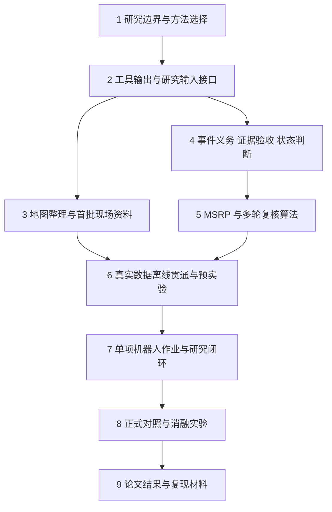

# 课题研究任务计划

初始规划：2026-11-18；研究实施流程更新：2026-11-22。起点为仓库初始基线 `7a8bc69`。首轮研究范围是受控通道、单个验证义务修订和一个选定的机器人能力配置。

现有模型与实验方案作为研究基线，后续推进算法实现、数据准备、必要的平台衔接及实验验证。GitHub Issue 保留历史设计验收，本页维护下一阶段的顺序、依赖和完成条件。2026-11-22 本轮交付是任务规划；下列待办尚未因此完成实现或实测。研究原型保留 S1—S8 逻辑职责，可先在一个进程内运行。

## 当前设计进展（2026-11-22）

Notion 与 GitHub 全线复审见[终审记录 §6](design/review-baseline.md)。复审提出的 D06—D10 五项已完成本轮限定模型选择、推导和纸面复核，交付保存在 [任务 #11](https://github.com/javencpdd/spatial-function-research-design/issues/11)。这一设计完成结论不替代现实输入资格、实验效果或正式系统冻结。

| 顺序 | 设计任务 | 完成标准 |
| --- | --- | --- |
| D06 · P0 · 已完成设计 | [安全观测启动与无告警发现](design/observation-bootstrap.md) | 已明确计划核验 Event/义务入口、独立安全与三值观测关系、固定周期及提前复核、条件性发现上界，完成三条贯通场景、十一项边界和完整监测成本。实际输入资格另行取证。 |
| D07 · P0 · 已完成设计 | [连续及未来时窗的证据支撑](design/spatiotemporal-support.md) | 已采用有限保守几何包络及受控保持区间，区分采样/物理支持/使用资格，给出空间与时间推导、四个核心场景及十二项边界；开放无约束未来不作外推。 |
| D08 · P0 · 已完成设计 | [全证据链的联合可靠性](design/joint-evidence-guarantee.md) | 已选择确定性集合主线，定义联合量词、误差传播、共因、统计接入与预算/停止规则，完成十五项边界。实际界和适用资格另行取证。 |
| D09 · P1 · 已完成设计 | [多轮复核策略](design/multiround-review-policy.md) | 已固定状态、完整候选/等待排序、实质签名与次数、在途和资源处理，完成四条全过程及十四项边界；不宣称全过程最优。 |
| D10 · P1 · 已完成设计 | [地图消费实例与贡献边界](design/map-consumption.md) | 已贯通拆分/重表达、配准更正、保证覆盖、净宽、验收及 S7；明确可复用/需重测边界，完成十六项边界与贡献/实验对应。 |

D06—D10 已交付。开题报告、14 页答辩稿、逐页讲稿与评审问答已对齐确定性净宽区间、完整时空支持、受控保持、多轮派工与地图换版的证据复用边界。报告正文及演示材料保存在本地。

### 当前工作顺序

用户负责 Lite3 或 M20 Pro 的建图、定位和导航。已按八个子系统核查可复用工具、领域代码及平台接口，结果汇总于[实验准备清单 §6](experiments/readiness.md#tool-reuse)。核心求解器和图/几何库作为候选基础组件，研究侧负责将现行规则转为可执行模型，并与用户的平台数据及任务接口衔接。

本轮工具选型以能力对应、源码/软件/权重获取及环境兼容为依据，暂无数据时不要求逐工具实测。已按 Ubuntu 20.04 机器人主机、Thor T4000 / JetPack 7.2 / Ubuntu 24.04 和可自由选择的外部工作站明确[平台分工](experiments/readiness.md#platform-layout)。通用计算工具有可获取实现，语义模型的具体环境、原始观测到合格证据的处理和双主机接口尚待落实；它们与算法设计并行，不以 Windows 合成调用替代 Thor 兼容或现场效果。尚不需要把全部模型迁入 Thor。

**近期先完成阶段 1–2 的方法选择与数据接口，再推进阶段 4–5 的离线算法；阶段 3 的地图和现场资料同步准备。** 先把证据资格、验收和事件义务规则做成可执行判断，再由 MSRP 消费这些判断。合成材料用于检查逻辑，真实资料用于检查输入假设；二者分别记录。完整流程、分工和通过条件如下。

## 从现有设计到论文结果的待办流程

主线为“研究边界与输入约定 → 算法和数据并行 → 真实离线回放 → 单项平台作业及闭环 → 对照实验 → 论文与复现”。每个阶段都保留未决及失败结果，不把已有工具、纸面案例或计划条目算作实现完成。

| 阶段与当前状态 | 待完成任务及主要产物 | 完成条件与依赖 |
| --- | --- | --- |
| **1 · 方法清单待落实** | 沿用受控直通道净宽、单义务和单机器人配置，固定待检验主张、事件类型与实验范围。逐项注明采用的论文/算法、复用组件、本课题修改、输入假设及对照；优先实现 E2/E3 主线，保留 E1/E4/E5 的闭环支撑。 | 研究主张能对应输出、独立参考和比较方法；已有研究方法与本课题贡献可区分。不要求四项业务能力分别提出原创算法。[模型基线](design/model-baseline.md)、[实验协议](experiments/protocol.md)。 |
| **2 · 输入接口待落实** | 在现有资料规格中补齐采集清单、字段与单位映射、缺项处理和一份明确标为合成的贯通样例。覆盖地图/实体/要求、维修及许可、原始观测、合格证据、候选作业、执行回执、验收与用途结果。 | 每个研究字段能追到工具原始输出、已确认配置或人工记录；保留原件、版本、时钟、来源和未知原因。预计覆盖与实得覆盖分别表示，模型输出到点标签一一对应。沿用现行对象与契约，不另行签发正式 Schema。[资料规格](experiments/corridor-data-spec.md)、[完整流程](design/model-baseline.md#workflow)。 |
| **3 · 真实资料待取得，可与 4–5 并行** | 用户提供 FAST-LIO2 几何图、位姿及原始观测；按数据选择一种语义辅助路线，人工修正研究区域并确认稳定编号、入口出口、高度带和关系。取得一组首轮受控采集及独立尺寸/时间参考、管理事实、物理保持和安全站位资料。 | 能把同一通道、同一地图修订和采集作业对应起来；原始/自动/人工修订可追溯。已有公开能力不代替实际数据可读性。先整理一个研究区域；这一组只用于接入和预实验，不构成正式样本量。[资料规格](experiments/corridor-data-spec.md)、[工具与平台](experiments/readiness.md#platform-layout)。 |
| **4 · 领域算法待完整实现** | 实现 S3 的管理/物理双轴与候选、S2/S4 的类型化影响和义务生成、独立证据验收器、S3 状态更新及 S7 五态查询。覆盖定时核验、现场线索、工单办结、证据失效与地图更正入口。 | 通过、失败、未决、冲突、过期、同源和局部覆盖按现行规则处理；验收资格与业务结论分开，旧证据充分时不派工。一个原始记录的重算不能增加独立见证。先用既有边界和手算参考检查；真实误差依据由 3/6 取得。[D01](design/impact-closure.md)、[D02](design/corridor-evidence.md)、[D07](design/spatiotemporal-support.md)、[D08](design/joint-evidence-guarantee.md)、[E5](experiments/availability-e5.md)。 |
| **5 · MSRP 统一算法待实现** | 将有限候选作业、联合见证分配、完整移动/等待/采集/结束路线、时窗与预算转为统一参考算法，接入 D09 多轮策略。可调用 OR-Tools；同时准备小域独立枚举参照，以及按完整增量成本的贪心、全区域复核等对照。 | 用同一实现覆盖现有二十类规划边界和四条多轮过程，核对路线、分配、成本、重派与停止原因；独立参照不直接复用被测规划器的判断结果。明确可行、无解、未知及最优性范围，求解超时不冒充业务无解。局部合成通过不替代后续实证。[MSRP](design/msrp-model.md)、[案例](validation/msrp-cases.md)、[D09](design/multiround-review-policy.md)。 |
| **6 · 真实离线回放与预实验待开展** | 将实际点云及位姿处理为有尺度、误差依据和保证时空覆盖的净宽证据，联通 4–5。标定测量、配准、时钟、可见范围、物理保持，以及作业时长和能耗。用真实到达顺序回放事件至用途判断。 | 能从原件复算一条宽度区间、覆盖缺口及结论；误差界须有适用模型与标定依据，少量样本最大残差不直接作为全域保证。检查两份独立合格见证是否现实可取得。缺乏资格时保留未决并修改采集设计，规则改变需重检相应案例。参考测量若供方法使用，另准备独立评分依据。该阶段依赖 3–5；根据预实验决定正式样本量与可支持主张。[测量前提](experiments/readiness.md)、[数据分组](experiments/corridor-data-spec.md)。 |
| **7 · 必要的平台衔接待完成** | 先验证一次“到获准观测位 → 采集 → 到允许终点”的作业，再接入自动事件/义务、规划、真实回执、验收、状态和用途反馈。用户负责建图、定位、导航及本地执行；研究侧完成任务与数据适配。 | 同一任务身份、地图版本、观测目标、实际资料、结束记录与实耗能够关联；覆盖到达失败、采集缺失、取消、失联及输入失效。导航成功与证据通过分别验收；执行状态未知时按现行边界处置。先离线联调再受控实机，单平台闭环不等于完整 E6 跨实现验证。[平台交接](experiments/readiness.md#tool-reuse)、[MSRP §8](design/msrp-model.md)。 |
| **8 · 正式实验待开展** | 预实验后锁定方法、参数、对照、分组、预算、停止规则、主要端点与样本量。优先完成 E2 影响分析、E3 复核规划及总体固定周期比较；完成 E1 双源、E4 恢复重开和 E5 条件查询的支撑验证与预定消融。 | 共享证据资格、输入到达流和资源条件；独立组先划分再派生，测试参考不反馈给算法。报告误判/漏检/未决、确认时间、完整路线及整个监测期能耗、计算成本与失败。真实回放可比较决策；采用实测成本还是仿真成本须明确，真机执行结论仅由实机记录支撑。[实验协议](experiments/protocol.md)、[统一准备清单](experiments/readiness.md)。 |
| **9 · 结果论文与复现待完成** | 写清采用与修改的方法、贡献、实验条件和局限；整理公式、算法、参数、数据来源及版本、运行入口、结果与失败案例。方法与相关工作章节可并行写，结果章节待实验。 | 每项研究主张对应可追溯结果；未获支持的假设和限定适用域照实报告。形成可复现的一次完整判断链。研究设计和可公开样例按既有约定发布；现场原件及权限范围单独处理。 |

### 四项能力的实现分工

| 能力 | 优先采用的计算基础 | 本课题需要落地的部分 | 验收位置 |
| --- | --- | --- | --- |
| 事件影响与义务生成 | NetworkX、空间关联与配置规则 | APCM 差异/周期入口、类型化传播、要求及证据模板实例化、去重与修订 | 阶段 4，E1/E2 |
| 证据验收 | Open3D 几何处理、空间/时间运算、结构检查 | 净宽区间、完整支持域、来源和共因、独立见证、冲突及双轴裁决 | 阶段 4/6，D02/D07/D08 |
| 最小充分复核规划 | 通用图计算、OR-Tools 或有限参考搜索 | 候选作业、完整路线与联合分配、资格未知、域内最优性及多轮反馈 | 阶段 5，E3 |
| 状态及用途判断 | 条件规则、空间计算、SQLite 版本记录 | 许可/物理双轴、恢复重开、精确版本、机器人和整个任务时窗的五态判断 | 阶段 4/6/7，E4/E5 |

文献复用不止限于基础库，也可采用已有规划、监测或估计方法作为组件和基线。具体采用关系在阶段 1 记录；安装工具本身不算上述能力实现。阶段 4 先固定实际验收器及资格接口，阶段 5 使用预计产证能力，收到回执后仍由阶段 4 的验收器判断实际结果。

### 近期三项交付与现实门槛

1. **方法及输入清单。** 在现有模型和资料规格补全“原始字段 → 研究字段 → 使用模块 → 缺项处理”，列出每项算法的复用来源与本课题修改；给出地图、观测、管理输入和作业回执的合成贯通样例。
2. **统一离线算法。** 先完成证据资格/验收及事件义务、状态规则，再接 MSRP 和多轮策略；回放既有二十类规划边界及四条过程，做独立核对和同条件对照。
3. **首条真实测量链。** 与算法并行取得地图、采集原件及独立参考，核验可支持的净宽范围、误差与时间，并确认第二份独立见证取得方式。若前提不足，先解决采集或缩小有依据的声明范围。

用户负责平台建图、定位、导航和现场操作；研究侧负责方法细化、输入规范、数据处理、算法、回放、评分和材料同步。人工地图整理及独立参考核实需现场人员参与。工作站先承担离线研究；Thor 按实际需要承担采集及感知，后续再核验上车模型环境。先取得实际接口和小规模预实验成本，再估算日历工期；本页不以未经估算的日期替代完成条件，开题报告原学期安排保留。

### 研究范围与人工参与

初始语义地图允许自动预分割与人工修正，优先处理研究通道边界及影响净宽的对象。保存修订并在各方法间共用，工作量单独记录。评分参考与方法输入分别保管；运行中若人工修正识别、选择动作或裁决结果，记入干预及耗时，并区分自动与人工协助结果。固定地图中的人工标签不替代新的现场测量。

首轮只需完成支撑研究结论的原型、数据处理、任务适配及复现入口。全校园自动标注、多机器人调度、八套独立服务、自研 SLAM/分割网络和整套治理平台不列入首轮必要任务。E6 跨实现、正式契约发布与生产部署按原门槛另行验证；需要对外宣称这些能力时才列入相应交付。研究计划沿用当前文档和 Notion 摘要，不为每一阶段新建页面。

## 已交付任务与范围

P0 为首先处理的基础定义，P1 为依赖基础定义的后续收敛与评审。

| 任务 | 优先级 | 要解决的核心问题 | 主要交付与验收 | 前置条件 |
| --- | --- | --- | --- | --- |
| [D01 事件影响闭包](https://github.com/javencpdd/spatial-function-research-design/issues/1) | P0 | 空间和功能依赖究竟允许怎样传播，公式与伪代码是否一致？ | 统一节点、边、属性过滤、传播规则与终止条件；六类纸面案例可复算，并保留原因路径。 | 无，首先启动。 |
| [D02 证据充分性与有效期](https://github.com/javencpdd/spatial-function-research-design/issues/2) | P0 | 什么证据足以验收一个通道义务，什么时候会失效？ | 形成属性、单位、覆盖、质量、时效、独立性及失效规则表；未知参数有标定计划与保守处理。 | 可与 D01 同期整理，验收前对齐义务作用域。 |
| [D03 MSRP 可行性与最优性](https://github.com/javencpdd/spatial-function-research-design/issues/3) | P1 | 何时能称可行、无解、未知或最小复核？ | 明确有限候选域、完整路线、证据分配、三值判据和成本顺序；复核原八例并补齐边界例。 | D01、D02 完成。 |
| [D04 E2/E3 实验方案](https://github.com/javencpdd/spatial-function-research-design/issues/4) | P1 | 怎样公平检验影响分析与复核规划的作用？ | 固定独立真值、分组划分、对照与消融、两种计时、风险界限、统计及失败处理。 | 可先整理结构；D01—D03 完成后定稿。 |
| [D05 跨模块纸面终审](https://github.com/javencpdd/spatial-function-research-design/issues/5) | P1 | 各局部模型能否连成完整且不矛盾的状态维护过程？ | 三个完整场景，研究目标与验证对应表，未决项分类，现行来源同步与可追溯的设计基线。 | D01—D04 完成。 |

D01 交付见[事件影响闭包](design/impact-closure.md)：采用有类型关系的确定/可能闭包，完成十一类手算案例；Notion MET §6.2.1 与开题报告 §3.3 已同步。

D02 交付见[通道净宽证据判据](design/corridor-evidence.md)。采用净宽谓词和两个独立见证的 `2-of-3` 模板，定义达标或共同反例的证据要求、失效规则、参数取得方法与十一类纸面案例。已同步 [Notion MET §10.4](https://app.notion.com/p/41280c1f022081febf3ae621f1e7c71a) 与开题报告 §3.4–3.5。

D03 交付见 [MSRP 数学模型](design/msrp-model.md) 与[二十类纸面案例](validation/msrp-cases.md)。采用有限离散时间候选域，逐条验证完整路线、预计验收时效和联合证据分配。确定候选支持可行，完整乐观候选均被排除支持无解，未排除分支保留未知。最优性按完整域或有效下界另证。已同步 [Notion 逻辑架构 §6.2](https://app.notion.com/p/41280c1f02208119a944debf8b5ca294)、MET §10.4 与开题报告 §3.4、§3.9。

D04 交付见 [E2/E3 实验方案](experiments/protocol.md)。已明确独立真值、分组封存、主要对照和消融、指标/分母、最优参照、稀有风险上界与样本量取得步骤，并完成八项纸面评分核对。主要比较沿用研究主页的确认时间与验证成本，恢复时间单列。已同步 [Notion APCM §F-06A](https://app.notion.com/p/41280c1f022081289425e18657438273) 与开题报告 §3.9。数据、标定与全部具体数值界在正式测试前锁定。

D05 交付见[研究设计终审](design/review-baseline.md)。完成三个版本、时窗和作用域明确的场景，核对覆盖、来源独立性、旧投影、风险界及反馈。开题报告文字、四处原生公式和摘要已同步，27 页逐页复核；Notion 系统级架构 §4.4 保存结论，正式冻结与实验效果仍按各自门槛取证。

## 推进顺序

1. **第一轮 D01、D02 已完成。** 闭包与通道证据模板已按属性、作用域和有效窗口对齐。
2. **第二轮 D03 已完成。** 完整路线、联合见证分配和候选完整性已对齐，原八例补齐前提并新增十二例。
3. **第三轮 D04 已完成。** E2/E3 的设计、统计和参数取得方式已明确，数据及数值界待按方案取得。
4. **第四轮 D05 已完成。** 贯通“事件—义务—复核—证据验收—功能状态—条件查询”，同步跨文档规则、报告与待实证事项。结论限于本轮声明的通道模型和纸面场景。

以每轮交付物验收为推进条件，不用未经估算的日期代替完成标准。修改前置规则时，重新检查受影响的后续任务。

总目标的当前闭环判定按[全线复审 §6](design/review-baseline.md)及[统一准备清单](experiments/readiness.md)维护。D06 固定安全观测和周期底线，D07/D08 固定支持与联合保证，D09 固定多轮策略和全过程账，D10 将地图版本消费落实到同一算例并收敛贡献范围。本轮声明域内已形成条件性的设计闭环；能否取得这些前提、真实效果及扩展域仍待验证。

## 设计完成的判定

- 每个采用的规则有明确语义、适用假设和选择理由；公式、文字、伪代码与纸面案例一致。
- 充分证据可以支持功能通过或失败；缺证、冲突、规划未知和实际受阻不能混为同一结论。
- 未定数值可作为待标定参数保留，但必须注明单位、来源、取得方法和未知时如何处理；阻碍逻辑闭环的规则矛盾须在终审前解决。
- 研究主张逐项对应论证或实验：E2/E3 优先检验影响分析与最小复核，E1/E4/E5 继续承担双源维护、恢复与条件查询的验证职责。
- 设计通过、参数标定完成、实验支持研究假设分别记录。研究设计基线不替代正式契约签发或外部互操作证明。

## 材料维护与后续阶段

继续更新现有模型、案例和实验方案；只有独立引用确有需要时才拆出新文档，不预建空目录，不导入整套历史档案。任务验收时附提交版本和来源；规则变化同时维护案例、Notion 摘要和开题报告，保持本轮终审记录可追溯。

发布约定（2026-11-18）：本研究设计线的后续文档、模型、实验方案、路线图与任务记录均默认批准公开发布到现有 GitHub 仓库。完成内容审阅与必要检查后直接同步并更新任务状态，不再逐项确认公开发布。

以下为 E1/E4/E5 及跨阶段复核的历史交付。近期任务见上方“当前工作顺序”。

| 顺序 | 设计任务 | 完成标准 |
| --- | --- | --- |
| 1 已完成设计 | [E1 双源状态维护实验](experiments/dual-source-e1.md) | 固定许可/物理双轴及当时可知参考，采用区间与硬过期分支、最近合格 Bundle 主要对照，明确错误开放/封闭、覆盖及弃权评分，完成十五项纸面复核。数据和数值仍按方案取得。 |
| 2 已完成设计 | [E4 恢复与重开实验](experiments/recovery-e4.md) | 固定局部义务、历史与当前支撑、重开/替代/复发分流、恢复/重开/投影三条时钟、强对照及七项主界，完成十八项纸面复核。 |
| 3 已完成设计 | [E5 条件可用性实验](experiments/availability-e5.md) | 固定请求与条件方案、五态证明、完整占用窗、风险界及选择有效性、精确读取/应用和七项主界，完成二十三项纸面复核。 |
| 4 已完成设计 | [跨阶段复核与统一实验准备清单](experiments/readiness.md) | 核对四个研究子目标及地图版本基础，修正规划判分、恢复时序与放行计数，列出独立参考、参数来源、联合功效与测试封存条件。 |

2026-11-22 起，本页已扩展到完成课题所需的算法、数据、必要的平台适配和实验任务。上述历史条目的“完成”均限于设计；后续实际执行按上方阶段验收。外部互操作、正式 Schema 发布与生产服务仍按各自工程门槛管理。

E1 本轮设计于 2026-11-18 完成，Notion APCM §F-06B 保存首轮选择、双时间参考和评分摘要。E1 的 O/N/A 是许可与净宽诊断，正式 S4 验收和 S7 放行分别由 E4/E5 承接。E1 完成不代表实际观测、标定或研究收益已经取得。

E4 本轮设计于 2026-11-18 完成，Notion MET §12.4 保存协议摘要并补齐 §9.6 的已有证据直接验收、当前支撑失效及要求替代边界。E4 只评价指定净宽义务及恢复依据，管理禁令、实际任务放行和真实 Consumer 证据仍按 E5/E6 取证。

E5 本轮设计于 2026-11-18 完成，Notion 逻辑架构 §8.1 保存限定五态、条件方案及评分摘要，§C-05 的硬失败/风险边界同步澄清。本轮交付覆盖离线实验协议和纸面规则。E1—E5 的统一准备清单及 D06—D10 模型选择与消费链均已完成。独立尺寸、时钟、管理记录和来源关系用于评估哪些主张能进入预实验。每次更改范围、阈值、时窗或分母时，重复对应反例并核对受影响的上下游判据。
